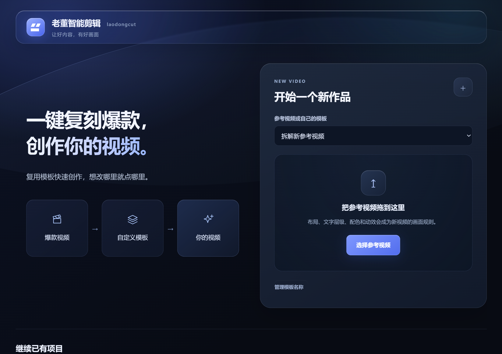
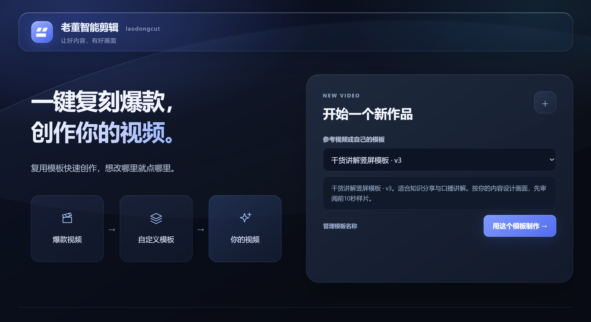
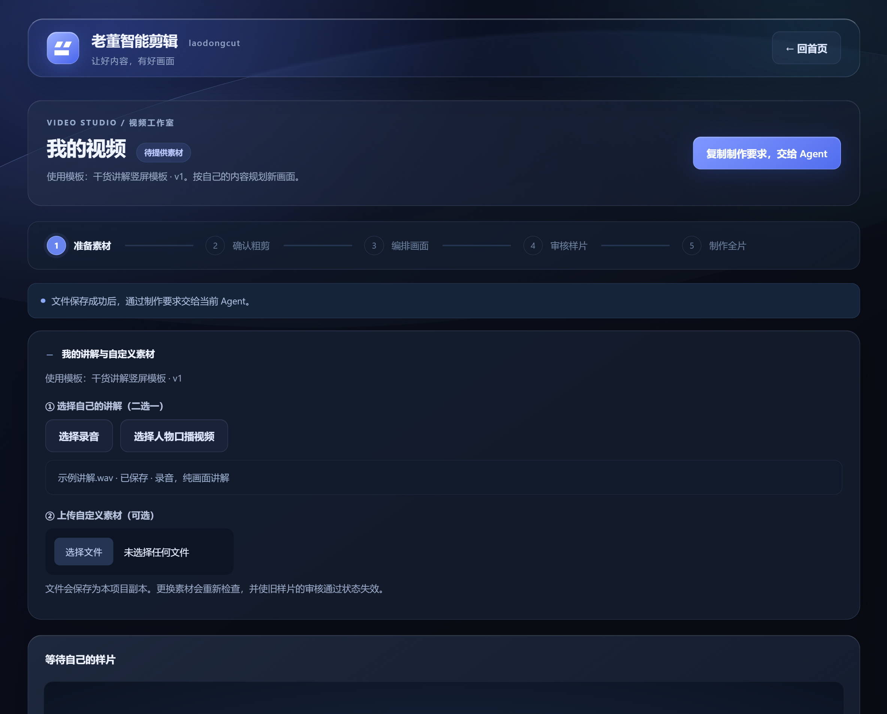
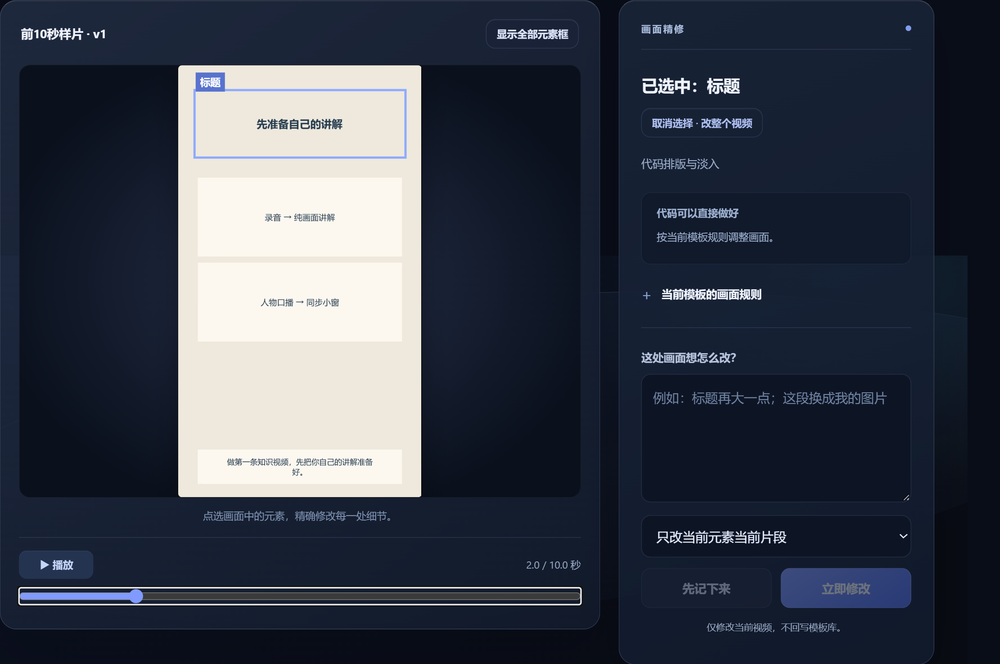

# laodongcut

**Turn your own narration or talking-head footage into a styled video, using a reference as creative direction. Click an element and describe the change you want.**

[简体中文](README.md) · [Download Skill](https://github.com/devindong1210/laodongcut/releases/latest) · [License](LICENSE)

> Early access. Source available. Free for personal non-commercial use. Commercial use, resale and ALL company use require prior written authorization from the original author.



## What it does

- Analyze a reference video's layout, colors, typography and motion through your agent; save the template after review.
- Import your own narration or presenter footage and plan a new video using that style.
- Review a preview of up to 10 seconds before approving the full render.
- Select individual visual elements and request changes in natural language; keep projects and output versions locally.

## Three steps

1. **Analyze a reference:** upload a video, click the analyze button, paste the generated task into the current agent conversation, then review and save the template.
2. **Add your footage:** select a saved template from the home page, import your audio or presenter video, and confirm the transcription and rough cut.
3. **Review and revise:** inspect the preview, click elements to request changes, then approve and export the full MP4.

<details><summary>More screenshots</summary>





Screenshots use an isolated original example. The review screenshot shows a compatible legacy layout, not a guarantee of arbitrary reference reproduction.
</details>

## Install or update

Download `laodongcut-v0.4.0.zip` from [Releases](https://github.com/devindong1210/laodongcut/releases/latest). Drag the ZIP into your agent conversation and say:

> Install this Skill and guide me through getting started.

You do not need to unpack it yourself. The agent checks for an existing installation, installs or updates the Skill, checks dependencies, and attempts to open the workspace in its built-in browser. First-time users receive step-by-step guidance. Attachment access, local execution and an embedded browser depend on the host.

To update, attach the new ZIP and say:

> Update this Skill and preserve my existing projects and media.

The installer backs up program files and preserves project data and configuration. To reopen later, ask your agent to open laodongcut. If no page appears, ask it to open the workspace in the current agent's built-in browser.

## Requirements

A host supporting local Skills, files and command execution is required. Tested in Windows + Codex. Installation and browser behavior in WorkBuddy, Doubao Work and other hosts have not been individually verified. The workspace UI is currently Chinese.

- Node.js >=20; prefer a currently supported LTS.
- Full FFmpeg with libass, FFprobe and a Chinese font.
- For voiced projects: working speech recognition with real timestamps, or reliable timestamped subtitles supplied by the user.

Existing tools are reused first. If ASR is missing, the agent can configure local faster-whisper using the official links and guidance in [dependencies.md](references/dependencies.md), currently in Chinese. The installation script does not bundle a universal dependency downloader, and `doctor` does not check ASR. Initial model download needs a network connection. No cloud credentials or accounts are included.

Original [reference video](examples/原创参考示例.mp4), [10-second sample](examples/前10秒示例.mp4) and [example notes](examples/说明.md) are included. Detailed task instructions live in [SKILL.md](SKILL.md).

## Current limits

The host agent performs reference understanding, transcription, visual planning and actual revisions. The workspace manages files, persistent tasks, reviews and versions. Tasks currently travel by copying from the page and pasting into the same conversation; automatic routing is not verified.

The built-in v3 renderer uses a fixed outer composition with content animation. The presenter layout library is creative guidance; arbitrary layouts and complex effects may need implementation and validation. Exact reproduction of any reference is not guaranteed. No platform downloading, avatar generation, batch production or automatic publishing is included.

## Local data and development

Project data, imported media and render history default to `data/`, or a separately specified data directory. The workspace listens on the local machine only. This repository and release exclude the developer's project database, private footage, credentials, model weights and third-party executables. External ASR runs according to its own actual configuration.

```sh
node scripts/cli.mjs doctor
node scripts/cli.mjs serve
npm test
```

Use the same data directory when resuming tasks. Do not bypass rough-cut or preview approval. Report bugs through [Issues](https://github.com/devindong1210/laodongcut/issues) without credentials, private file paths or unauthorized media.

## License and contact

[laodongcut Personal Non-Commercial License 1.0](LICENSE): individuals may use, study, modify and redistribute free copies for personal non-commercial purposes while retaining notices and identifying changes. Commercial use, resale, paid services/bundles and ALL company or enterprise use, including internal use and evaluation, require the original author's prior written authorization.

Third-party components retain their licenses. Previously valid grants for older releases are not retroactively revoked. This is a custom **source-available license**, not an OSI-approved open-source license. The Chinese license text prevails.

Original author: **老董 (Laodong)**. WeChat: **xiaoqiangdz**, including commercial and company licensing inquiries.
