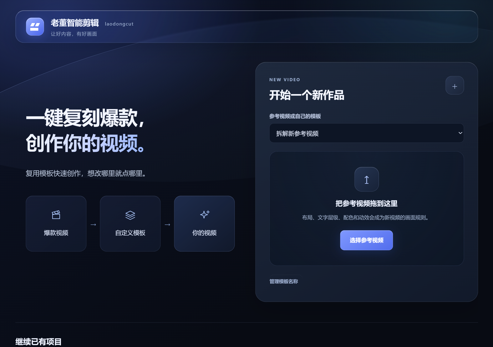
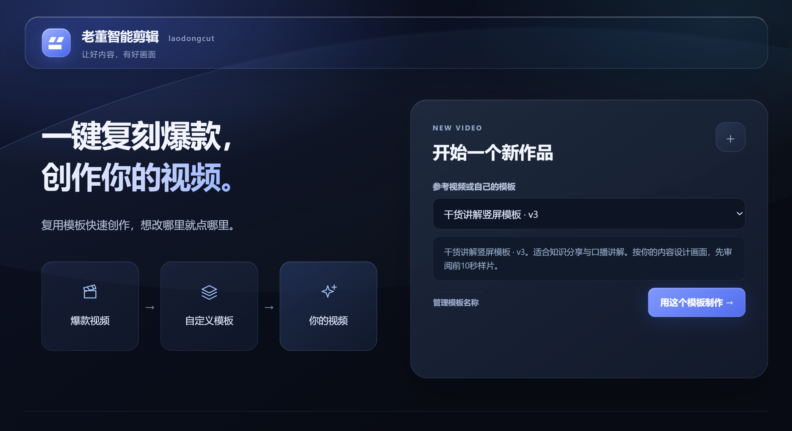
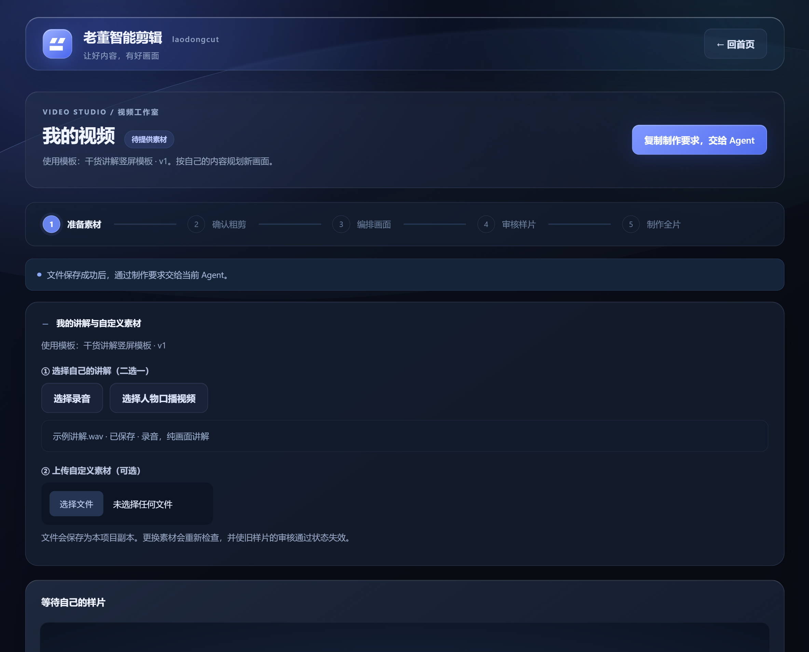
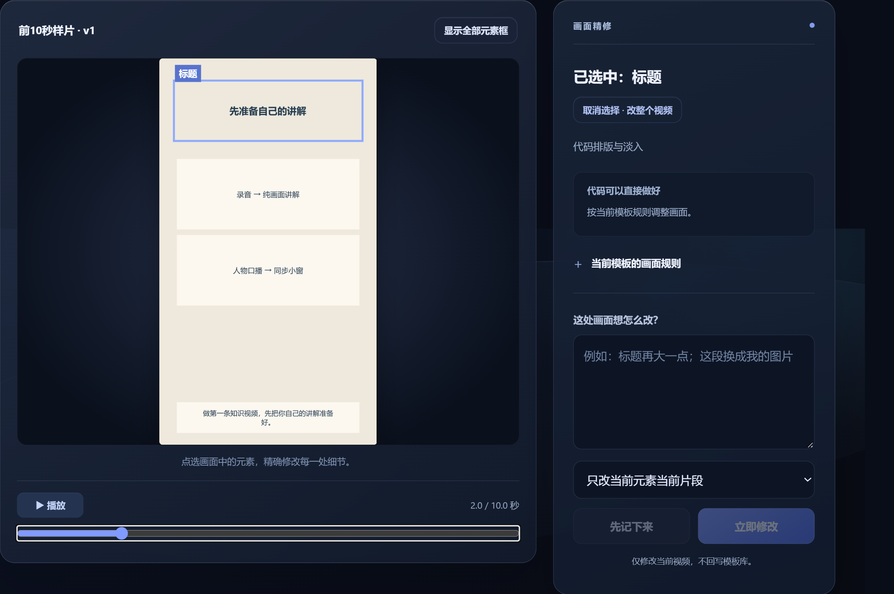

# laodongcut / 老董智剪

**参考喜欢的视频风格，把自己的口播剪成视频。想改哪里，就点哪里，用大白话告诉 AI。**

[English](README.en.md) · [下载 Skill](https://github.com/devindong1210/laodongcut/releases/latest) · [使用说明](https://tcnsvhijuipu.feishu.cn/docx/ZD6HdqCxAofsGVxo0yLc7hsvnTb) · [许可](LICENSE)

> 小范围内测。源码公开，个人非商用免费。商业用途、转售和公司使用须取得原作者书面授权。



## 能做什么

- **参考拆解**：由 Agent 观察参考视频，提取布局、配色、文字层级和动效规则，经你确认后保存为模板。
- **同款风格剪辑**：上传自己的录音或人物口播，基于模板规划画面，先审核前10秒样片，再制作完整版。
- **点选修改**：选中标题等画面元素，用自然语言提出修改意见；支持整片意见和版本恢复。
- **本机工作台**：在 Agent 对话旁打开页面，选素材、看结果、审核并导出 MP4。

## 三步使用

| 步骤 | 你要做什么 |
| --- | --- |
| 1 自动拆解爆款模板 | 上传参考视频，点击“拆解该视频”，把要求复制给当前 Agent；检查并保存模板。 |
| 2 添加素材，自动剪辑 | 从首页选择模板，上传自己的录音或人物口播，把制作要求交给 Agent，确认粗剪。 |
| 3 出片加修改 | 看样片、点击元素提意见；样片通过后制作并下载完整版。 |

<details><summary>查看选模板、上传素材和修改界面</summary>





截图使用独立原创示例，审核截图为兼容布局，只说明入口；实际画面随模板和规划变化。
</details>

## 安装与更新

1. 在 [Releases](https://github.com/devindong1210/laodongcut/releases/latest) 下载 `laodongcut-v0.4.0.zip`，不用自行解压。
2. 把压缩包拖进支持本机操作的 Agent 对话，说：

> 帮我安装这个 Skill，并带我开始使用。

AI 会检查已有安装和依赖、安装或更新 Skill，并优先在当前对话旁的内置浏览器打开工作台。首次使用按步骤引导。内置浏览器和附件访问取决于宿主能力。

更新时，把新版包拖进对话，说：

> 帮我更新这个 Skill，保留已有项目和素材。

安装器会备份原程序并保留项目、素材和配置。以后直接说“打开老董智剪”；没有显示页面时说“请在当前 Agent 的内置浏览器里打开老董智剪工作台”。

## 环境与依赖

需要能读取本机文件、执行命令并使用 Skill 的 Agent。当前在 Windows + Codex 环境验证；WorkBuddy、豆包工作等平台的安装与浏览器行为尚未逐一实测，不承诺所有平台即装即用。界面目前为中文。

- Node.js：>=20，建议使用仍受支持的 LTS。
- 包含 libass 的完整 FFmpeg、FFprobe，以及中文字体。
- 有声口播需要实际可用、能返回时间戳的语音识别，或用户提供的可靠带时间字幕。优先复用已有能力；缺少时由 Agent 按 [依赖配置指引](references/dependencies.md) 配置开源 faster-whisper。

**依赖配置由 Agent 执行。** 当前安装脚本不自带全部依赖下载器，`doctor` 不检测 ASR。首次模型下载需联网；不存在自动注册账户或内置云端密钥。

包内包含原创 [参考示例](examples/原创参考示例.mp4)、[10秒示例](examples/前10秒示例.mp4) 和 [示例说明](examples/说明.md)。更完整的操作与命令见 [操作说明](docs/OPERATIONS.zh-CN.md) 和 [Skill 指令](SKILL.md)。

## 当前能力边界

参考理解、ASR、画面规划和修改语义由宿主 Agent 实际执行，页面负责任务、素材、审核和版本。页面生成的要求需复制回当前对话，尚未验证自动发回当前对话接口。

内置 v3 为固定外框和内容动效的兼容渲染器；布局库提供多种构图指引，任意多机位与复杂特效可能需要扩展代码并验证。不能保证任意参考一键原样复刻。不含平台下载、数字人生成、批量生产或自动发布。

## 数据与开发

素材、项目和历史结果默认保存在安装目录的 `data/`，也可指定独立数据目录。运行时本地页面仅监听本机。代码仓库和发布包不包含开发者项目库、私人素材、密钥、模型权重或第三方程序；ASR 等外部工具按其实际配置运行。

```sh
node scripts/cli.mjs doctor
node scripts/cli.mjs serve
npm test
```

使用同一数据目录继续任务；不要手改状态绕过粗剪和样片审批。修改与建议欢迎通过 [Issues](https://github.com/devindong1210/laodongcut/issues) 提交，请勿上传密钥、个人路径或未获授权素材。

## 许可与联系

本次发布采用 [老董智剪个人非商用许可 1.0](LICENSE)：

- 自然人个人、非商用使用、学习、修改和免费分享：允许，须保留许可、署名并标注修改。
- 商业使用、转售、付费打包、收费服务及任何公司/企业使用（包括内部使用、评估）：事先取得老董书面授权。
- 第三方软件、字体和模型遵守各自许可。本许可不追溯撤销旧版本已合法授予的其他许可。

本项目是 **source-available（源码可用）**，含用途限制，不属于 OSI 标准开源许可。

联系原作者：**老董** · 微信 **xiaoqiangdz**。商业和企业授权请联系作者。
